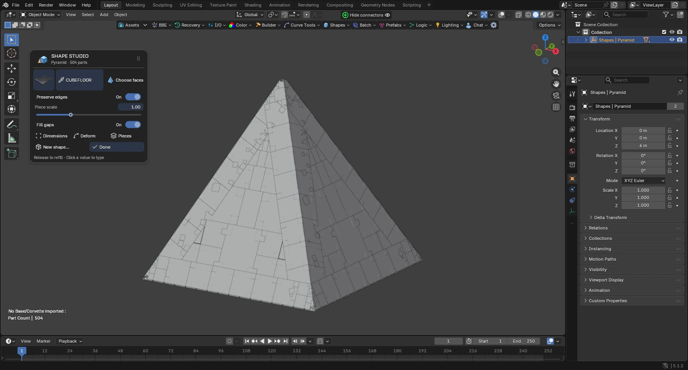
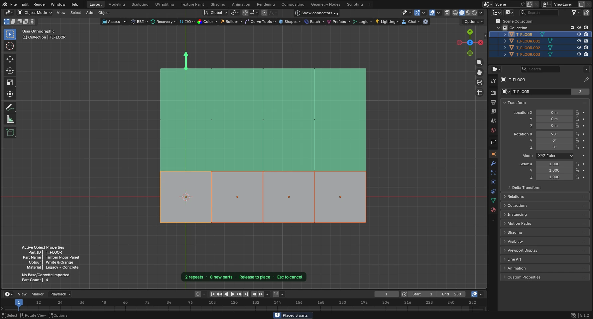
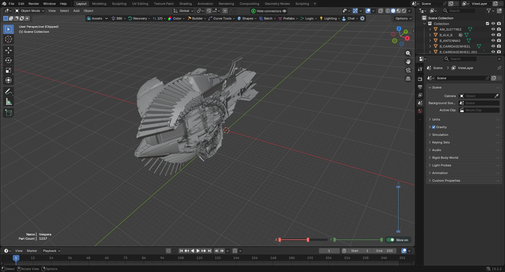
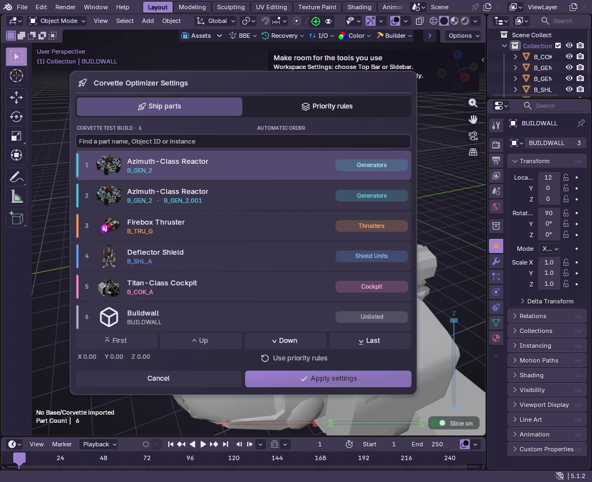

# Building with BBE 18.2.118

Choose a feature in the [release notes](https://github.com/slipperystickers/nms-base-builder/releases/tag/v18.2.118), or use the table of contents above this guide. Inside Blender, the **?** on a menu opens its instructions beside your build.

## Shape Studio for 2D shapes and 3D shells

Open **Shapes**, choose **2D Shape** or **3D Shell**, then click a thumbnail. Click the part ID to type an ID or pick an asset from the viewport or browser. For a triangle, choose Fill, set the outward-facing side of the part, then raise Edge detail until the corners look right. Use Part limit to cap the number of pieces. On a shell, use Populate shell faces to leave surfaces open. Reselect a piece to bend, pinch, twist or resize the group. **New Shape** reuses your part and offers cursor or feature alignment.

## Repeat Along at snap sockets

Select one wall, floor or roof and click **Repeat Along** beside it. Click a socket, then drag an arrow and release to place the run. Select the entire row and repeat in the perpendicular direction to lay a floor. Shared wall junctions work as starting points. Supported freighter sections and Corvette habs follow their sockets. Straight pipes and bubble tubes continue forward.

## Stack Corvette habs and add stairs

Repeat a compatible hab using a vertical socket. To add a staircase afterward, select the two connected habs and click **Add Stairs**. Choose a shared landing when the pair offers more than one.

## Duplicate along an axis or edge path

In **Builder**, choose **Duplicate Along Axis** or **Duplicate Along Edge Path**. Pick X, Y or Z for an axis run, or trace the edges for a path. Adjust quantity and spacing in the duplication controls. Extra copies continue beyond the last edge in its final direction.

## Align by point, edge or face

Select the object to move and open **Builder → Align**. Choose Point, Edge or Face, pick the feature on the moving object, then pick its counterpart on the stationary object. Review the alignment and adjust the rotation around the connection.

## Object-origin mirroring and transform copying

In **Builder**, choose the mirror axis and **Object Origin** as the pivot. Toggle Duplicate when you want to keep the original. For position, rotation or scale, open **Transform** in the sidebar and use its copy and paste controls on the source and destination selections.

## Curve connections, tapered runs and progressive twist

In **Curve Tools**, draw in Top / Down for a flat path and adjust Control points after drawing. Use Curve Connections to join endpoints with a line, bring curves together, or start a new curve at a point. For repeated parts, set Spacing until the first two touch, apply Taper, and increase quantity if the run falls short. Set Twist along curve to 360° for one turn. Corkscrew and Spiral also have Radius taper. Use Blender Tools keeps the native gizmo available.

## Hab-specific utility walls and windows

Snap a crew berth, nutrition unit, medipod, living wall, refiner, mission radar or supported window into a compatible hab wall socket. The fitting takes its host’s appearance. Switch to Detailed Proxies to inspect the textured result.

## Edit Message Modules in the viewport

Select a Message Module, click **Edit Message** beside it, enter the message and confirm. BBE writes the text to the object's Message property.

## Viewport cutaway on three axes

In **BBE → Workspace Settings → Display**, enable Viewport Cutaway. Drag either end of the X, Y or Z slider inward from the build’s outer edge. Use the corner switch to compare the slice with the whole build. The slice carries across Solid, Wireframe and Material Preview. Choose Refit to Build after enlarging a build.

## 1000u base boundary rings and sphere

Import a planetary or space base. In the Outliner, expand **BBE Build Boundary**. Use the eye icons to show the rings or wire sphere. The guides are centered at the base origin and stay out of exported builds.

## Supply pipes and editable cable endpoints

Open **Logic**, choose Supply Pipe and click **Place Cables**. Click two orange sockets, or click free positions. Detailed Proxies show the twin tubes as you stretch them. Use the axial rotation ring to roll both tubes together. Move a free endpoint independently or bring it to a matching socket and choose Snap Endpoint. Attached ends follow their devices. Select a cable and use Ctrl+C and Ctrl+V to copy it with its endpoints.

## Color-coded connectors and a visibility switch

Use **Show connectors** in the viewport header. Look for blue electrical, cyan teleport, pink ByteBeat, orange supply and green structural targets. The placement cursor matches the cable type. Finish or cancel placement to return to the visibility you chose.

## Bubble-tube chain checks before export

Export the build normally. If BBE identifies an unfinished opening, return to that junction and attach a matching tube or remove the incomplete junction. Retry the export once the chain is complete.

## Horizontal asset browser and visual variants

Click the arrow beside **Assets**. Scroll sideways to browse or use the bottom search field to search across categories. Drag the lower handle to resize. Click a tile’s two-bar badge to browse its variants, then Close variants to return. The sidebar and pop-out browsers also show visual variants and a back arrow. In the pop-out, use Reorder to arrange the category list.

## Corvette part bonus tooltips

Hover over a supported reactor, thruster or other Corvette part in an asset browser. The tooltip shows the relevant bonus ranges before placement.

## Local prefab thumbnail previews

Choose **Presets / Prefabs** in the horizontal browser or **Presets** in the other browsers. Enable **Prefab Previews** to generate thumbnails for visible prefabs. Click one to place the group. The local library in Prefabs uses the same previews. Switch previews off to browse by name on a slower system.

## Community prefab galleries by Discord channel

Open **Prefabs → Online Community Prefabs**. Choose a community tab and search its cards. Click a thumbnail to enlarge it, then close it to return to the same position. The download icon adds the prefab to your library. The server title opens its invite when supplied. Drag the lower grip to resize the catalogue.

## Material finish icons and viewport color sampling

Open **Color**, choose a palette family, and use the finish icons above the swatches to select a style. Click a swatch to paint selected parts. To sample a placed part, choose Pick Colour from Object and click the part in the viewport.

## Guided imports and exports in Save Manager

Enable Save Manager in **I/O**. Choose the account, slot, build type and name. Green marks Import from Save when the selected build needs loading. The view frames the imported build. After editing, blue marks Optimize & Export for a Corvette or Export to Save for a base. Review the destination before confirming. Use Copy All for full build data or Copy Objects when the destination expects an array of parts.

## Manual Corvette part ordering and cockpit swaps

Open optimizer settings beside **Optimize & Export**. In the ship-parts list, locate the actual instance, use the move controls to change its place, then apply. Its category color matches its priority rule. For a pair, open **Builder → Cockpit / Object order**, select the two instances and swap them. Their positions in the viewport stay fixed.

## Build timer and idle tracking

In **Workspace Settings → Display**, turn on Build Timer and set the idle interval. Read the elapsed time alongside the selected build in Save Manager.

## Customizable menus, workspace and language

Open **BBE → Workspace Settings**. On Top Bar or Sidebar, drag handles to reorder the menus, use their switches to choose which appear and save the layout. Display contains language, WASD and viewport settings. Simplify Blender Workspace reduces the visible tabs; click Restore to bring them back. In Themes, choose a palette or change Blender Button Style.

## Searchable and draggable How-To browser

Click **?** on a BBE menu to open its instructions. Browse by category or search for a tool in the selected interface language. Drag the title bar to keep the guide beside your work.

## Smart edge tracing tolerance

Open Curve Tools and choose Curve from Edges / Faces. In edge mode, adjust the turn tolerance to control how sharply the chain can turn through a vertex. Hover over the branch you want before confirming the traced path.

## Shared backup folder and retention settings

In Save Manager, open the folder settings beside the heading. Choose the shared backup location and the number of generations to retain per slot. Existing backups stay in their original folder. Use the folder button to inspect the backups.

## Remembered decal and workspace settings

Set up a decal with the projection options you want before placing the next one. BBE remembers the settings for subsequent placements. Workspace Settings also remembers navigation and display choices across sessions.

## Offline interface languages

In BBE, open Workspace Settings, then Display. Choose English, Italian, Filipino, Simplified Chinese or Traditional Chinese, or select Follow Blender. Open the How-To browser to search the translated instructions.
